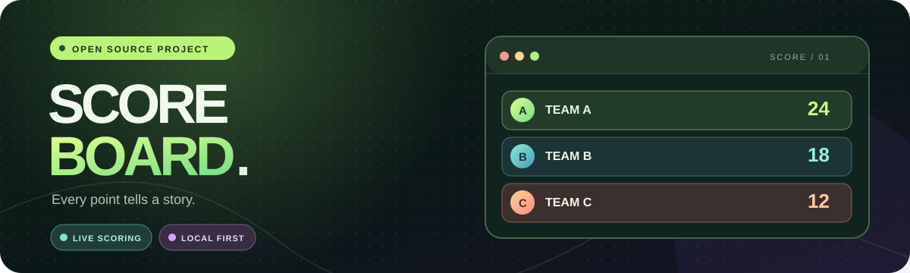
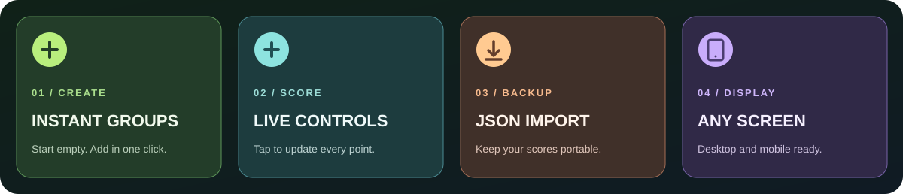

[🌐 言語を選択](../../README.md) · [繁體中文](./README.zh-TW.md) · [简体中文](./README.zh-CN.md) · [English](./README.en.md) · **日本語**

[📚 Wiki ガイド（繁体字中国語）](https://github.com/easonlin2013927/score-board/wiki) · [🐛 不具合・機能提案](https://github.com/easonlin2013927/score-board/issues/new/choose)

<p align="center"></p>

<h1 align="center">Scoreboard · イベント用スコアボード</h1>

<p align="center">チームを作成し、得点を記録できるシンプルなスコアボードです。</p>

<p align="center"><a href="https://easonlin2013927.github.io/score-board/"></a></p>

> アプリは繁体字中国語、簡体字中国語、英語、日本語に対応しています。画面右上で切り替えられます。入力済みの名前と得点は変わりません。

## ✨ 主な機能



| 機能 | 使い方 |
| :--- | :--- |
| 🟢 **チームを作成** | 初回表示時にチームはありません。「チームを追加」を押すと「新しいチーム」がすぐに作成されます。カードの鉛筆アイコンから名前を変更できます。 |
| ⚡ **得点を更新** | 加減点ボタンを使うか、得点をクリックして整数を直接入力できます。1 回の加減点数も設定できます。 |
| 🏆 **順位を確認** | チームは得点順に並び、チーム数、最高得点、首位のチームが表示されます。 |
| 🧹 **ボードを管理** | ボード名の変更、チームの削除、確認後の全得点リセットに対応しています。 |
| 🗂️ **複数のボード** | ボードの作成、切り替え、複製、削除に対応。チーム、ルール、履歴はボードごとに保存します。 |
| 🧮 **得点ルール** | 1 回につき 1～100 点、マイナス得点の可否、同点時の同順位または作成順を設定できます。 |
| 🕓 **変更履歴** | ボードごとに直近 200 件の加減点、直接設定、リセットを記録します。 |
| 📲 **インストールとオフライン** | 対応ブラウザーではサイトをインストールでき、初回のオンライン読み込み後はオフラインでも開けます。 |
| 📦 **インポートとエクスポート** | JSON バックアップを保存し、別のブラウザーや端末で読み込めます。読み込み前にデータの上書きを確認します。 |
| 🖥️ **全画面表示** | チーム、合計得点、ラウンドの残り時間を大きく表示します。 |
| ⏱️ **タイマーとラウンド** | 各ラウンドの時間を設定し、開始・一時停止できます。前のラウンドの得点も確認できます。 |
| 🖼️ **結果の画像** | 順位を PNG 画像として保存し、共有できます。 |
| 📱 **画面サイズに対応** | ダークテーマの画面はデスクトップとスマートフォンの両方に対応しています。 |

## 🎮 使い始める

**オンライン：** **[easonlin2013927.github.io/score-board](https://easonlin2013927.github.io/score-board/)** を開いてください。登録やインストールは不要です。

**URL の変更：** ブラウザーの保存データはサイトの URL ごとに分かれます。旧 URL で記録したボードを残す場合、各ボードを JSON に書き出し、新 URL で読み込んでください。

**ローカル：**

```bash
git clone https://github.com/easonlin2013927/score-board.git
cd score-board
```

ブラウザーで `index.html` を開きます。静的サイトのため、依存パッケージのインストールやビルドは不要です。

### イベントでの操作例

1. タイトル横の鉛筆アイコンからボード名を変更します。
2. 「チームを追加」を押し、作成されたカードの鉛筆アイコンからチーム名を入力します。
3. 加減点ボタンを使います。大きく変更する場合は得点をクリックして入力します。
4. 終了後に「スコアボードをエクスポート」を押し、JSON ファイルを保存します。

## 💾 データとバックアップ

名前と得点は**現在使用中のブラウザー**の `localStorage` に自動保存されます。ページを再読み込みしても残りますが、端末間では**自動同期されません**。別の端末へ移すには、JSON をエクスポートしてから移行先でインポートしてください。

インポートすると現在のボードと得点が置き換わります。実行前に確認画面が表示されます。更新後も以前のチームが表示される場合は、そのブラウザーに保存されたデータです。アプリ内で削除するか、このサイトのブラウザーデータを消去してください。

## 🔒 データと公開前の情報

スコアデータは現在のブラウザーに保存されます。サイドバーの「端末の全ボードデータを消去」は全ボードを削除します。必要なら各ボードを先に JSON で保存してください。読み込みと書き出しは選択中のボードだけが対象です。オフラインでのインストールには HTTPS またはローカルサーバーが必要です。`index.html` を直接開いても通常の得点管理はできます。サイトには[プライバシー、利用条件、Cookie、プロジェクト情報](https://easonlin2013927.github.io/score-board/legal.html)があり、リポジトリには[公開前チェックリスト](../../LAUNCH_CHECKLIST.md)と[素材の記録](../../ASSET_NOTES.md)があります。

## 🚀 GitHub Pages にデプロイ

このリポジトリは GitHub Pages を使用し、`main` ブランチの `/(root)` から自動公開されます。自分のサイトを公開する場合はリポジトリを Fork し、**Settings → Pages → Build and deployment** で **Deploy from a branch**、`main`、`/(root)` を選んで **Save** を押してください。静的サイトなのでビルドコマンドは不要です。

独自ドメインは **Settings → Pages → Custom domain** で設定し、[GitHub の公式ガイド](https://docs.github.com/en/pages/configuring-a-custom-domain-for-your-github-pages-site)に従って DNS を設定できます。

## 🧩 ファイル構成

```text
score-board/
├─ index.html         # 画面とダイアログ
├─ styles.css         # 基本スタイルとレスポンシブ表示
├─ github-link.css    # サイドバーの GitHub ボタン
├─ language.css       # 言語選択メニューのスタイル
├─ features.css       # タイマーと全画面表示のスタイル
├─ extras.css         # 複数ボード、ルール、履歴のスタイル
├─ i18n.js            # 4 言語の画面テキスト
├─ app.js             # 得点、保存、インポート、エクスポート
├─ pwa.js、sw.js       # インストールとオフラインキャッシュ
├─ manifest.webmanifest、icons/  # インストール情報とアイコン
├─ favicon.svg        # サイトアイコン
└─ docs/              # README 用画像と翻訳
```

<p align="center"><strong>🎯 すべての得点に、思い出を。</strong></p>
